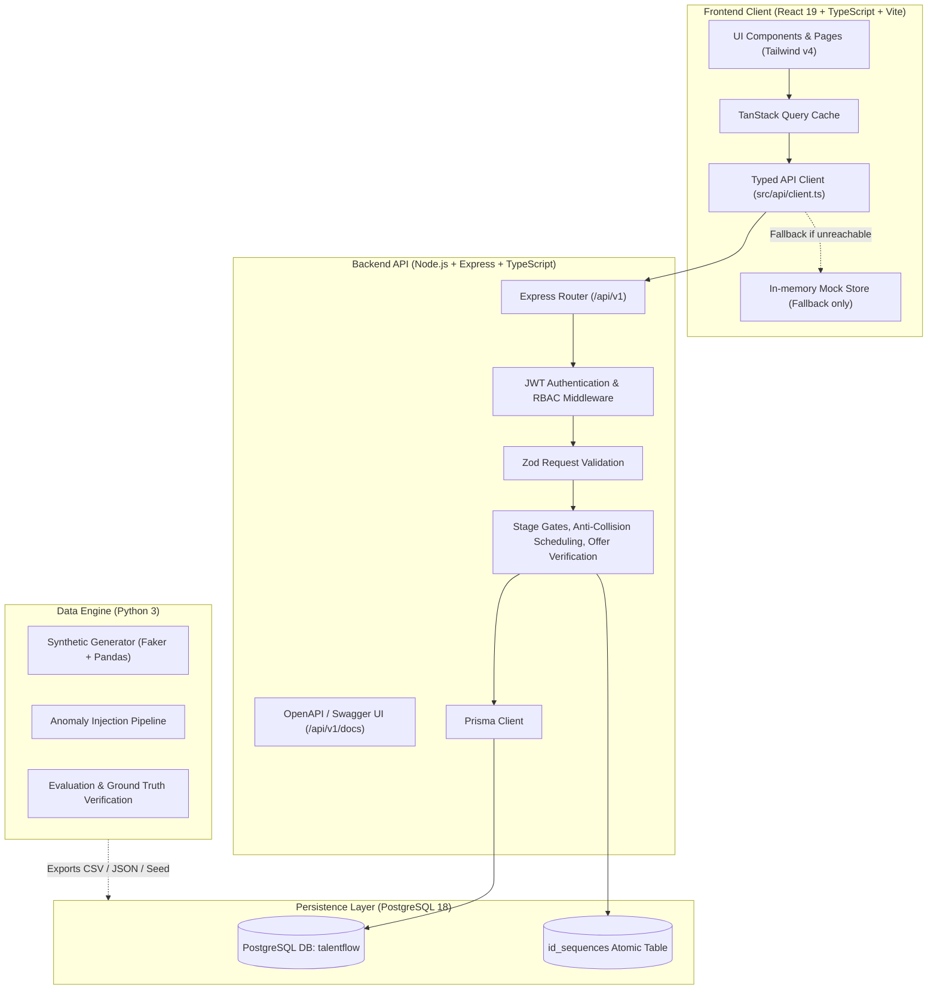

# TalentFlow Architecture & System Design

## 1. System Architecture

TalentFlow is designed as a **Modular Monolith** pairing a React 19 + TypeScript enterprise frontend with a Node.js + Express + Prisma + PostgreSQL production API, supported by an offline Python synthetic data & validation engine.

## 2. Security & Access Control Model
- **Authentication**: JWT bearer tokens signed with HMAC-SHA256 (`JWT_SECRET` min 32 chars).
- **Role-Based Access Control (RBAC)**:
  - `Admin`: Full organizational control, role assignment, settings.
  - `Recruiter`: Requisition creation, candidate sourcing, stage transitions, offer preparation.
  - `HiringManager`: Requisition submission, application reviews, scorecard assessments.
  - `Interviewer`: Panel evaluations, rubric ratings, availability management.
  - `Approver`: Separation-of-duties authorization for requisitions and offers.
- **Separation of Duties**: Requisitions and offers cannot be approved by their requester.
- **Audit Logging**: Every mutation emits an immutable `AuditEvent` capturing actor, action, entity, before-state, after-state, and timestamps.

