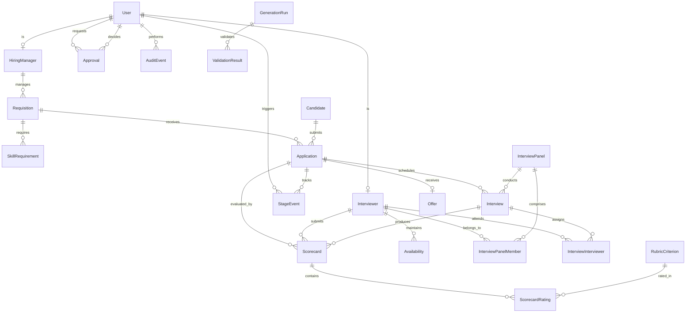

# TalentFlow Database Entity-Relationship Diagram (ERD)

The following diagram represents the complete PostgreSQL relational schema implemented via Prisma ORM for TalentFlow.

## Immutable Business ID Schemes
- **User**: `USR-000001`
- **Requisition**: `REQ-YYYY-000001`
- **Candidate**: `CAND-000001`
- **Application**: `APP-CAND-000001-REQ-YYYY-000001`
- **Interview Panel**: `PNL-000001`
- **Interview**: `INT-YYYY-000001`
- **Scorecard**: `SCORE-INT-YYYY-000001-USR-000004`
- **Offer**: `OFF-YYYY-000001`
- **Approval**: `APR-000001`
- **Audit Event**: `AUD-000001`
- **Generation Run**: `GEN-000001`

